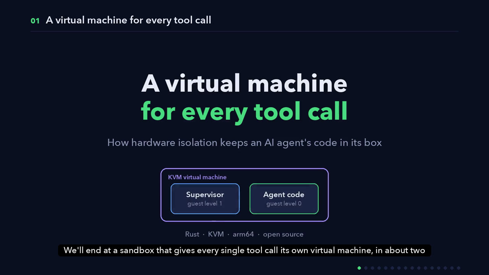
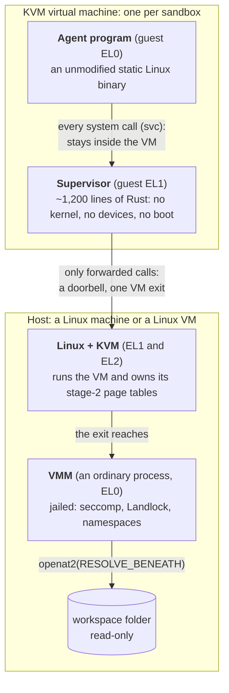
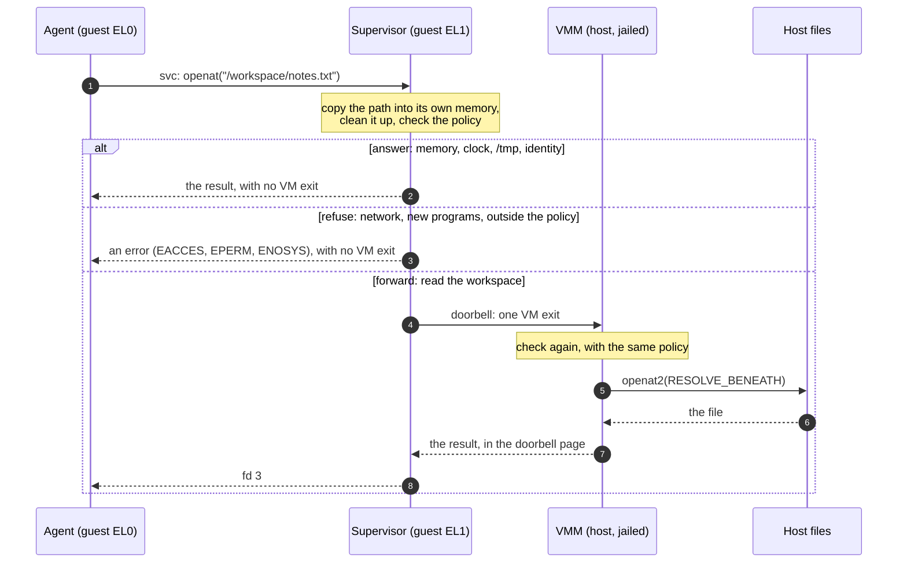
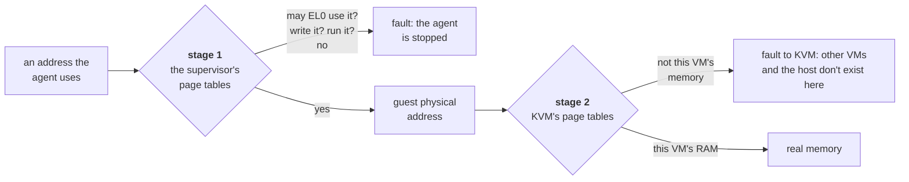
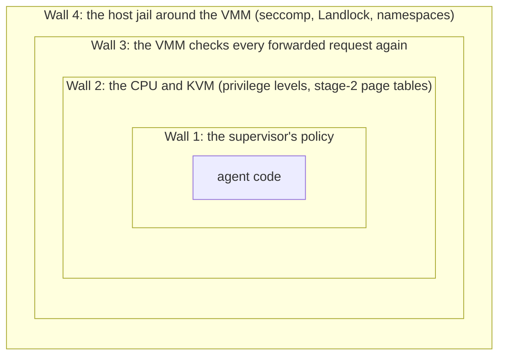
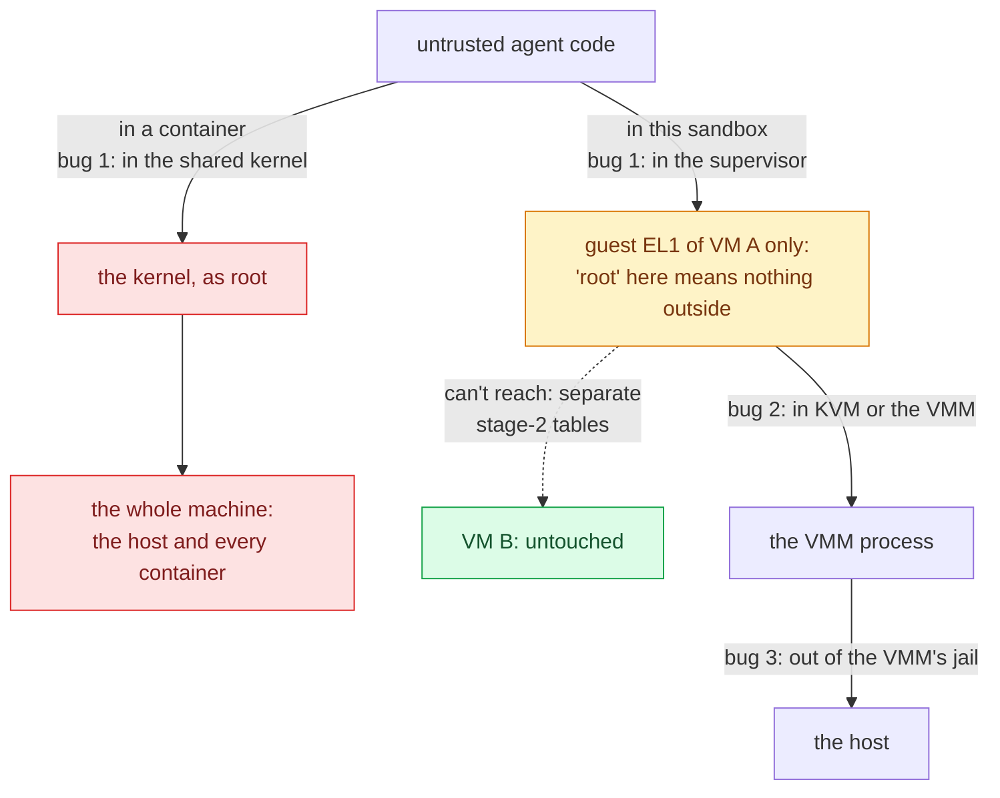
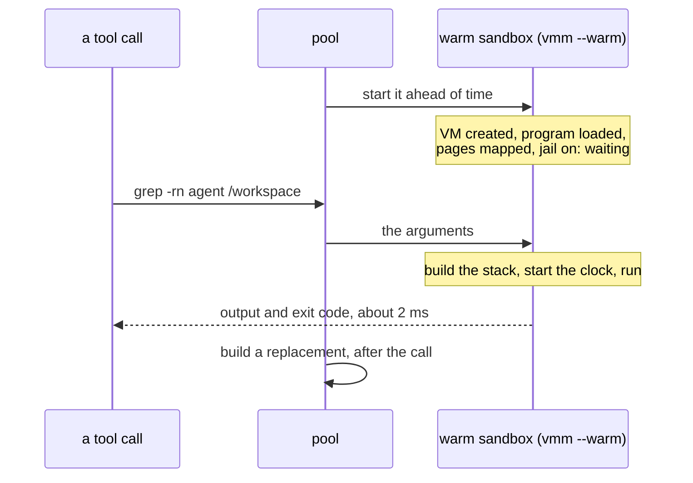

# kvm-agent-sandbox

Run untrusted agent code inside a KVM virtual machine **without a guest kernel, without emulated devices, and without
booting anything**. A ~1,200-line Rust *supervisor* sits at the guest's kernel level and becomes the program's kernel: every
Linux system call the program makes is **answered**, **refused** or **forwarded** according to a policy file. Only
forwarded calls leave the VM, and the VMM carries them out on the host inside a jail.

The program itself is an ordinary, unmodified static Linux binary: a Rust program with the standard library, or real
tools such as Alpine's `busybox` (`ls`, `find`, `grep -r`, `awk`, `sed`, `tar`, `sh` scripts with built-in commands). It
doesn't know it's sandboxed. It can read a host folder (read-only) and write to `/tmp`, which lives in the VM's memory, so
**nothing it writes ever reaches the host**.

> Status: a working research prototype from a book on writing a VMM from scratch. It is **not** audited and not ready
> for hostile production traffic. The limitations are listed below.

## Watch: how it works (8.6 minutes)

From the CPU's privilege levels and page tables, through how exploits happen and why containers share one kernel, to
hardware virtualization, this sandbox's design, its tests and its performance.

[](https://allthingssecurity.github.io/kvm-agent-sandbox/)

**[▶ Play it in the browser](https://allthingssecurity.github.io/kvm-agent-sandbox/)** (with subtitles and chapters). Full quality (1080p) and the `.srt` file: [release `video-v1`](https://github.com/allthingssecurity/kvm-agent-sandbox/releases/tag/video-v1).
The video is generated from [`video/`](video/) (`python make_video.py`, needs macOS `say`, ffmpeg and Pillow).

## How it works

### The big picture



- **The agent** is the untrusted code: an ordinary Linux program that doesn't know it's sandboxed.
- **The supervisor** plays the part of the program's kernel. It answers, refuses or forwards each system call, and it
  is the only code inside the VM with privileges.
- **The VMM** is the only part on the host. It creates the VM, loads the program, carries out the few forwarded calls,
  and is locked down itself.
- **KVM and the CPU** keep the whole VM inside its own memory.

### Who runs at which CPU level

An arm64 CPU runs code at *exception levels*: EL0 for programs, EL1 for a kernel, EL2 for a hypervisor (x86 calls them
ring 3, ring 0 and VMX root). Code at a lower level can't touch the memory, registers or instructions of a higher one;
if it tries, the CPU stops it and hands control to the level above. A VM gets its own EL0 and EL1.

| CPU level | On the host | Inside each sandbox VM |
|---|---|---|
| **EL2** (hypervisor) | KVM | — |
| **EL1** (kernel) | Linux | **the supervisor** (instead of a guest kernel) |
| **EL0** (programs) | the VMM, and the host's other programs | **the agent program** |

So the agent is at the bottom of both stacks. Its system calls reach the supervisor, never the host's Linux directly.

### Start-up, in three steps

1. **The VMM** opens `/dev/kvm` and creates a VM with 256 MiB of address space; the host spends memory only on pages
   that are touched. It loads the supervisor and the agent's ELF the way Linux's `execve` would: segments, then the
   starting stack with argv and auxv. It writes the page tables and the **policy table**, then starts one vCPU at guest
   EL1.
2. **The supervisor** points the CPU's exception "door" (`VBAR_EL1`) at its own handlers, turns the MMU on, and drops
   to guest EL0 at the agent's entry point.
3. **From then on, every system call** (`svc`) of the agent jumps to the supervisor. That happens inside the VM, so it
   isn't an exit.

### One system call, step by step



| Bucket | Examples | VM exits |
|---|---|---|
| **Answer it** | Memory (`brk`, `mmap`), signal setup, `clock_gettime`, identity (`getpid`, `uname`, `getuid`), limits; the **fd table** (`dup3`, `fcntl`, `close`), the **current folder** (`getcwd`, relative paths), and **every file operation in `/tmp`**: `openat`, `read`, `write`, `mkdirat`, `renameat`, `unlinkat`, `getdents64`, `newfstatat` | **0** |
| **Refuse it** | Paths outside the policy, writes outside `/tmp`, `socket`, `clone`/`execve`, anything unknown | **0** |
| **Forward it** | `write` to stdout, reading `/workspace` (`openat`, `read`, `newfstatat`, `getdents64`, `readlinkat`, `chdir`), `getrandom`, `nanosleep` | 1 each |

About 70 Linux system calls in all. The supervisor keeps the state a kernel keeps for a process: a table of 64 file
descriptors (with offsets shared after `dup`, as on Linux), the current folder, and `/tmp`'s file table. Paths are
cleaned up by text before any check (`""`, `.` and `..` are resolved), so what the prefix check sees is exactly what
gets opened.

Forwarding works like this. The supervisor checks the call, copies paths into its own memory, writes a request to a
shared page and "rings the doorbell": a store to an address with no memory behind it. KVM hands that exit to the VMM,
which performs the real host system call and writes back the result.

A fault (touching forbidden memory, a privileged instruction) stops the agent. Every decision goes into an audit log in
supervisor memory, which the VMM reads and prints after the run.

### How memory is protected: two checks on every access



The MMU makes both checks in hardware on every memory access, with no software involved. The supervisor writes stage 1;
KVM writes stage 2, and the guest can't change it. Inside the VM, the memory is split like this:

| Guest memory | Agent (EL0) | Supervisor (EL1) |
|---|---|---|
| Supervisor code | no access | read and run |
| Supervisor constants; the policy; the boot record; the page tables | no access | **read only** |
| Supervisor data: audit log, path copies, fd table, its stack | no access | read and write, **never run** |
| `/tmp` file data (up to `tmp_kb`) | no access | read and write, never run |
| Agent code | read and run | read |
| Agent data, heap, `mmap` area (up to `memory_mb`), stack | read and write, **never run** | read and write |
| Everything else: the gaps between regions, memory past `memory_mb` | **unmapped: fault** | **unmapped: fault** |

On top of that, the CPU's `WXN` bit makes any writable page non-executable, whatever its entry says. When the agent
hands the supervisor a pointer, the supervisor asks the MMU (`AT S1E0R` / `AT S1E0W`) whether the agent itself could
read or write that memory. So the supervisor never touches anything on the agent's behalf that the agent couldn't touch.

### Walls, from inside out



1. **The supervisor's policy**, inside the VM: allow or deny per system call, with an errno; path prefixes checked on
   the supervisor's own copy of the path; memory limits; and every pointer checked by the MMU (see above).
2. **The CPU and KVM**: the agent at guest EL0 can't touch supervisor pages or change the door register. Memory past
   `memory_mb` isn't mapped at all, and `/tmp`'s data sits in pages only the supervisor (EL1) can touch, capped by
   `tmp_kb`. Stage-2 page tables confine the whole VM to its own RAM.
3. **The VMM's checks and limits**:
   - It re-checks every forwarded request with the same policy.
   - It opens workspace files only through `openat2(RESOLVE_BENEATH)`, starting from a handle on the workspace folder.
     The kernel refuses any path, symlink or `..` that would leave it, in the same step as the open.
   - It writes results only into the agent's own memory areas.
   - It enforces a wall-clock watchdog (by interrupting `KVM_RUN`), an output cap and an open-files cap.
   - A full audit log stops the agent instead of losing entries.
4. **The host jail on the VMM process**:
   - **seccomp**: 35 host system calls. `ioctl` only for `KVM_RUN`, `write` only to stdout and stderr, no `PROT_EXEC`
     in `mmap`/`mprotect` (no new executable memory for injected code), no write flags on `openat`.
   - **Landlock**: the VMM can open files only beneath the workspace, read-only. No TCP. Signals and abstract Unix
     sockets only within its own sandbox.
   - **rlimits and more**: no new processes, no core dumps, not dumpable (other processes of the same user can't read
     its memory or `/proc` files), and its own user, IPC and UTS namespaces.
   - The self-test (`--jail-selftest`) proves it: `open("/etc/passwd")` is refused, and `socket()` kills the VMM with
     SIGSYS.

### Policy as data

```ini
time_limit_ms   = 3000
memory_mb       = 32
tmp_kb          = 4096       # /tmp, in VM memory; 0 = no /tmp
max_output_kb   = 64
max_open_files  = 8
workspace       = ./workspace
read            = /workspace/

allow = brk mmap munmap mprotect madvise set_tid_address rt_sigaction rt_sigprocmask sigaltstack
allow = write writev read readv openat close fstat newfstatat lseek getdents64 readlinkat getcwd chdir
allow = dup dup3 fcntl mkdirat unlinkat renameat ftruncate getrandom nanosleep clock_nanosleep
deny socket socketpair bind connect = EACCES     # no network
deny clone clone3 execve            = EPERM      # no new processes
```

Anything not mentioned is refused, and unknown keys or system-call names are errors. The same supervisor binary obeys
whatever policy it's given: see [`policies/`](ch01d-real-agent/policies/).

## Why this is safer than a container

A container is a set of Linux features around a normal process. **Namespaces** change what it can see, **cgroups** limit
how much it can use, and **seccomp** filters which system calls it may make. But every container on a machine talks to
**the same kernel**, through the same roughly 350 system calls. So one exploitable kernel bug that's reachable from
inside is enough to control the kernel, and with it every container and the host. Real examples:
- Dirty Pipe ([CVE-2022-0847](https://nvd.nist.gov/vuln/detail/CVE-2022-0847)): unprivileged code could overwrite
  read-only files.
- The netfilter bug [CVE-2024-1086](https://nvd.nist.gov/vuln/detail/CVE-2024-1086): a normal user could become root,
  and it has been exploited in real attacks.
- runc's "Leaky Vessels" ([CVE-2024-21626](https://nvd.nist.gov/vuln/detail/CVE-2024-21626)): a container could
  reach the host's files.

Here's what one bug buys an attacker in each design:



| An attacker who found... | a shared-kernel bug (container) | a supervisor bug (this sandbox) |
|---|---|---|
| Privileged inside its own box | yes | yes |
| Root on the host machine | potentially yes | no: needs bug 2, then bug 3 |
| Other tenants' sandboxes | potentially yes | no: separate stage-2 tables, enforced by the CPU |
| Host files and network | potentially yes | only through checked, forwarded requests |

A compromised supervisor can make the program *believe* it's root, but the host has no Linux process for the agent to
promote. It only sees the VMM, an ordinary jailed process. Firecracker-style microVMs share this property. The
difference here is that there's no guest kernel to boot, so a fresh VM per tool call costs milliseconds.


## Measured numbers

From a MacBook (Apple M4 Pro), inside a Lima VM running Alpine Linux 6.18 with **2 vCPUs and 1 GiB RAM**, using **nested
virtualization**: every VM exit crosses two hypervisors, so exits are slower than on bare-metal Linux. The laptop was
also running other work. Treat these as conservative, single-machine numbers; bare-metal runs are still to do.

**Per tool call**, the same commands on the same machine
([`results/warm-pool.txt`](ch01d-real-agent/results/warm-pool.txt)), median / p99:

| A call to `busybox …` | `cat` a file | `grep -rn` over the workspace | `sha256sum` | `ls -la` |
|---|---|---|---|---|
| Plain process, no isolation | 0.77 / 1.59 ms | 0.79 / 1.37 ms | 0.73 / 0.86 ms | 0.84 / 1.08 ms |
| Fresh namespace sandbox per call (`bwrap`: new user, pid, net, mount namespaces) | 2.97 / 3.89 ms | 3.06 / 3.91 ms | 2.93 / 3.58 ms | 2.98 / 3.74 ms |
| **Cold VM per call** (`vmm`: everything at call time) | 3.96 / 5.04 ms | 4.60 / 5.40 ms | 4.22 / 4.83 ms | 4.15 / 4.92 ms |
| **Warm VM per call** (from a pool, see [Warm pool](#warm-pool-a-fresh-vm-in-about-2-ms)) | **1.56 / 2.14 ms** | **2.14 / 2.77 ms** | **1.55 / 2.40 ms** | **2.12 / 2.93 ms** |

Every call gets a VM nobody used before, even from the pool. A warm VM costs about 1 ms more than a plain process, and
about 1 ms *less* than a fresh namespace sandbox.

**Sandboxes in bulk** ([`results/loadtest.txt`](ch01d-real-agent/results/loadtest.txt)), with the default memory set-up
(2 MiB pages for code) and with 4 KiB pages everywhere (`VMM_HUGEPAGES=none`):

| | 2 MiB pages for code (default) | 4 KiB pages everywhere |
|---|---|---|
| **Cold start**: new process, create VM, load the ELF, supervisor starts, agent prints a line, VM exits | **p50 3.0 ms**, p99 3.5 ms | p50 4.2 ms, p99 5.3 ms |
| **Throughput** on 2 vCPUs (full lifecycle per sandbox) | up to **515 sandboxes/s** | up to 338 sandboxes/s |
| **Memory per idle sandbox** (host memory actually consumed: VMM process, guest pages touched, KVM structures) | 6.1 MB: 100 idle sandboxes in 605 MB | **3.1 MB**: 190 idle sandboxes in 579 MB |
| **CPU with every sandbox idle** | 0.2% of the machine | 0.0% |
| Memory returned after killing all | yes | yes |

Speed or density: the choice is one setting. (2 MiB pages *everywhere* is worse on both counts: 4.1 ms per warm call and
21.5 MB per sandbox, because every scattered region then costs a zeroed 2 MiB page.)

Raw outputs: [`ch01d-real-agent/results/`](ch01d-real-agent/results/).

The demo agent (heap, a hash map, file reads, five forbidden actions) makes **51 system calls: 27 answered inside the VM,
8 refused inside the VM, 16 forwarded**. That's **17 VM exits** in total, and the run takes 10–30 ms including VM creation.
`grep -rn` over the workspace makes 39 system calls, and 14 of them leave the VM.
`mkdir -p /tmp/a/b/c` makes 20 system calls and **one** exit, the final one.

## Warm pool: a fresh VM in about 2 ms

Where did a cold call's time go? `VMM_TIMINGS=1` prints it. For `grep -rn`, about 7.5 ms at first:

| Part | Time |
|---|---|
| Start and end the VMM process | 0.65 ms |
| Read the program and the policy | 0.9 ms |
| Load the program, build page tables | 0.9 ms |
| Lock the VMM down (seccomp, Landlock, watchdog) | 0.9 ms |
| Create the VM and vCPU | 0.1 ms |
| Run: the program, its page faults and its 14 exits | ~5 ms, of which the actual `grep` is well under 1 ms |

The run itself was the surprise. Under nested virtualization, every TLB miss inside the sandbox walks three sets of page
tables: the sandbox's, the Linux VM's and macOS's. With 4 KiB pages there are many misses. Pre-mapping pages saved almost
nothing on its own. **2 MiB pages for just the program's code and the supervisor** cut a warm call from 7.1 to 2.3 ms
(and a cold one from 6.7 to 4.5 ms), for about 2 MB more host memory per sandbox.



The warm pool then moves everything else off the call's path:
- `vmm --warm` does all the set-up, including the jail. The supervisor maps the pages the program will need (pre-mapping
  is worth it once code uses 2 MiB pages: 5.7 → 2.5 ms). Then it rings a "ready" doorbell, and the VMM waits on stdin.
- A call writes its arguments. The VMM builds the program's stack and starts the clock for the time limit (it starts at
  the call, not while waiting). Then the program runs.
- [`pool`](ch01d-real-agent/vmm/src/bin/pool.rs) keeps N such sandboxes ready and builds a replacement **after** each
  call, so building never competes with a running call for the CPUs.

Honest limits of these numbers:
- **Back-to-back calls** empty the pool; each call then waits for a sandbox to be built, which is slower than a cold
  start (5–6 ms). Agents leave seconds between tool calls (the model is thinking), which is where a pool shines.
- **After about a second of idling** everything here gets slower: a plain process goes from 1 ms to 5–6 ms, and a warm VM
  to 9–10 ms. The Mac lets the Lima VM's CPUs sleep, and waking them, plus the nested state, costs that. On a busy
  server or bare metal this should mostly vanish, but it is not measured yet.

## Can it run any code? Tested with Hermes Agent and deepagents

**Not yet: no Python, no shell pipelines.** It runs static Linux binaries that stay within the ~70 system calls the
supervisor implements. We checked what two real agent frameworks would run inside a sandbox:

- **[deepagents](https://github.com/langchain-ai/deepagents):** its sandbox backend implements every file tool (`ls`,
  `read_file`, `glob`, `write_file`, `edit_file`) as a `python3 -c "..."` command sent through `execute()`.
- **[Hermes Agent](https://github.com/NousResearch/hermes-agent):** `terminal()` runs bash. `execute_code` runs a Python
  script that calls tools back over a Unix socket, or through request files for remote backends.

We extracted the exact commands and scripts from their source and traced them with `strace` on Alpine Linux
([`compat/`](ch01d-real-agent/compat/), raw output in
[`results/compat-agent-frameworks.txt`](ch01d-real-agent/results/compat-agent-frameworks.txt)):

| | First version | Now |
|---|---|---|
| Distinct system calls the 8 workloads use | 54 | 54 |
| Implemented by the supervisor | 25 | **46** |
| **Missing** | 29 | **8**: `execve`, `clone`, `wait4`, `pipe2` (running programs), `rt_sigreturn` (delivering signals), `socket`, `connect`, `epoll_create1` (Hermes' callback channel) |

Two caveats:
- **`mmap`:** it counts as implemented, but only anonymous memory is supported. Python's loader also maps its library
  files.
- **Python itself:** it is a dynamically linked program that opens hundreds of files at start-up.

**What runs today:** unmodified real-world static binaries. The loader accepts static PIEs, the usual static build on
Alpine and most distributions. [`compat/run-busybox.sh`](ch01d-real-agent/compat/run-busybox.sh) runs Alpine's
`busybox` (1.1 MB, not recompiled); results are in [`results/busybox.txt`](ch01d-real-agent/results/busybox.txt):

| | Result |
|---|---|
| Reading: `ls -la`, `find`, `grep -rn`, `cat`, `head`, `tail`, `wc`, `sort`, `awk`, `sed`, `md5sum`, `sha256sum`, `base64`, `od`, `xxd`, `stat`, `du`, `diff`, `cmp`, `realpath` | **all work**, 3.9–6.0 ms each, VM included |
| Writing to `/tmp`: `mkdir -p`, `cp`, `tar -cf` | **work**, entirely inside the VM |
| `sh` scripts with built-in commands: redirects (`>`, `>>`, `<`), `while read`, `for f in *`, `cd`, arithmetic | **work** |
| `uname`, `id`, `nproc`, `date`, `env` | **work** |
| Writing to `/workspace`, `ls /` | refused, as intended |
| `sh -c 'cat f \| wc -l'`, or any non-built-in command in a script | **fails**: needs `pipe2`, then a new program (`execve`) |
| `free`, `ps` | fail: there is no `/proc` |

**What's left for Hermes and deepagents:**
1. **Running programs.** This design has a shortcut: a VM starts in about 4 ms, so `execve` could start a *new sandbox*
   (one program per VM), with the VMM connecting their pipes. Python's `subprocess` and most tools spawn new programs
   rather than truly forking. A real `fork`, which shells use for pipelines, is harder.
2. **Python.** It needs a static build, file-backed `mmap`, and threads.

Until then: use this sandbox for known tools and static programs, and a microVM for "run anything".

## Security testing

[`run-redteam.sh`](ch01d-real-agent/run-redteam.sh) runs a hostile agent ([`redteam/`](ch01d-real-agent/redteam/)). It
tries what a prompt-injected agent tool would try, using raw `svc` instructions so it can pass any number and any
pointer. Results ([`results/redteam.txt`](ch01d-real-agent/results/redteam.txt)):

| Attacks | Result |
|---|---|
| **Steal host secrets**: `/etc/shadow`, `~/.ssh/id_rsa`, `~/.aws/credentials`, `/proc/self/environ`, `/proc/self/mem`, `/proc/1/root/...`, `/dev/kvm` | 9/9 refused |
| **Escape the workspace**: `..`, `/workspace//etc/passwd`, planted symlinks to `/etc/passwd` and `/etc`, prefix confusion, 300-byte paths | 7/7 safe. The supervisor stopped 4; `//` resolves inside the workspace (`ENOENT`); **the VMM's second check stopped the 2 symlinks** |
| **Write, create or persist in `/workspace`**: write/append/truncate opens, `mkdir`, `unlink`, `symlink`, `link`, `rename`, `chmod`, `chown`, and a check that nothing appeared | 12/12 refused |
| **Network and processes**: TCP and Unix sockets, `connect`, `execve /bin/sh`, `clone`, `clone3`, a 1,000-iteration fork bomb | 8/8 refused, 0 processes created |
| **Host kernel attack surface**: `ptrace`, `bpf`, `io_uring`, `userfaultfd`, `perf_event_open`, `mount`, `unshare`, `setns`, `keyctl`, `init_module`, `process_vm_readv`, `seccomp`, unknown numbers | 17/17 refused |
| **Turn the supervisor against itself**: pass pointers to its code, policy, page tables, audit log or doorbell page (or to the agent's own read-only code, or a 2^64-byte length) to 11 different system calls | 17/17 refused with `EFAULT` (+1 allowed open) |
| **Memory and fd games**: mmap length overflow, 1 TiB, `MAP_FIXED` over the supervisor, mapping a file, `brk` into the supervisor, pointers into unmapped holes, fd exhaustion, closed fds | 13/13 handled |
| **Folders, current folder, relative paths**: `chdir` to `/etc`, `..` or a symlink to `/etc`; relative `../etc/passwd` and symlinks from `/workspace`; `openat` relative to a folder fd or to stdout; `stat`/`lstat`/`readlink` on symlinks pointing out; `getdents64`, `getcwd`, `uname`, `stat` writing into supervisor memory; signals to other processes; raising limits; `setuid(0)` | 32/32 |
| **`/tmp`**: `/tmp/../etc/passwd`; renaming files out to `/workspace` or in from it; `rmdir /tmp`; a folder into itself; read-only and write-only fds; unlink while open (the data stays readable, as on Linux, and a new file with the same name starts empty); a 1 TiB seek and a 1 TiB `ftruncate`; 70 open files (`EMFILE` at 64); 300 files (table full, names free again after unlink); filling `/tmp` past `tmp_kb` (`ENOSPC` at 4 MiB) | 22/22 |
| **Must stop the sandbox**: read the policy, erase the audit log, edit page tables, patch its own code, run code from the heap, stack or supervisor, `msr vbar_el1`, `msr sctlr_el1` (MMU off), `hvc`, `smc`, `eret`, `dc zva` on the log, ring the doorbell, touch memory outside RAM or beyond the memory limit, overflow the stack, `wfi`, sleep for an hour, spin | 21/21 stopped by the CPU or the watchdog |
| *(138 checks that must be refused or answered correctly, in all)* | **138/138 pass** |
| **Fuzzing**: 100 runs × 8,000 random system calls (63 different allowed calls plus random numbers) with hostile arguments: supervisor addresses, holes, huge lengths, paths like `..`, `/tmp/a`, `escape-link` | **800,000 calls, 0 supervisor crashes; all 100 runs finished** |

**The first run found three real bugs** ([`results/redteam-before-fixes.txt`](ch01d-real-agent/results/redteam-before-fixes.txt)):

1. **The memory limit didn't hold against direct stores.** With `memory_mb = 32`, the agent wrote to 83 MiB it never
   asked for: the page tables mapped the whole mmap area, and only `mmap` respected the limit. **Fix:** memory beyond
   `memory_mb` isn't mapped at all. A side effect: a stack overflow now faults instead of silently running into the
   mmap area.
2. **The supervisor could be crashed.** It checked pointers against an address range, but that range has unmapped gaps.
   A pointer into a gap made the supervisor itself fault, in 14 of 20 fuzz runs. That was fail-closed (only that
   sandbox died) but agent-triggerable. **Fix:** every pointer is checked with the MMU's own `AT S1E0R`/`AT S1E0W`
   translation, so the supervisor touches only what the agent could touch.
3. **An `mmap` length near 2^64 wrapped around** in the round-up and "succeeded" with zero bytes. **Fix:** checked
   arithmetic.

A defense-in-depth change came with the fixes: the VMM now writes forwarded results only into the agent's own areas,
without trusting the supervisor's check.

**Round 2: folders, the fd table and `/tmp`** roughly doubled the supervisor. Its new tests found one real bug:
`poll` always answered "nothing ready", and a shell's `read` treats that as a timeout. Rust programs never noticed. No new
security bug was found. One expectation changed: `/workspace//etc/passwd` now returns `ENOENT`. On Linux `//` means `/`,
so the path is `/workspace/etc/passwd`. In round 1 it reached the host's `/etc/passwd` path through a quirk of Rust's
`Path::join`, and only the VMM's canonicalize check stopped it.

**Round 3: hardening without a performance cost** ([`results/hardening-ab.txt`](ch01d-real-agent/results/hardening-ab.txt)):

| Change | What it stops | Proof |
|---|---|---|
| **The supervisor is mapped W^X.** Code is read-only and executable, constants read-only, data never executable; the policy, boot record and page tables are read-only even for the supervisor; only the regions it uses are mapped, with gaps as guard pages; `SCTLR_EL1.WXN` on. Before, its whole 16 MiB area was read-write-execute. | A bug in the supervisor can't be turned into rewriting its code, its policy or its page tables | `vmm --supervisor-selftest 1..8`: patching its code, editing the policy, page tables or boot record, running code from data, writing below its stack, reading a gap, writing a constant all fault |
| **Overflow checks on** in the supervisor | A silent arithmetic wrap-around becomes a clean stop | 300,000+ fuzzed calls: none triggered |
| **seccomp argument filters, Landlock scopes, non-dumpable, namespaces** for the VMM | A compromised VMM gets no executable memory, can't open for writing, can't signal or connect to other sandboxes, and other processes can't read its memory | `vmm --jail-test NAME` for 8 attempts: 6 killed by seccomp, 2 refused by Landlock |
| **`openat2(RESOLVE_BENEATH)`** for every workspace access (it replaced "canonicalize, check, then open by name") | No window between check and open, without relying on Landlock | [`race-test.sh`](ch01d-real-agent/race-test.sh): a host process swaps a folder for a symlink to `/etc` while the agent opens through it; 30,000 opens, **0 leaks** |
| **KVM firmware services hidden** (random-number and paravirtual-time services, vendor calls) | Less hypervisor code reachable from a compromised supervisor | The VMM prints "hidden: 3 of 3" |

The cost, measured by running the old and new builds alternately: **none measurable** (3.70–3.76 ms against 3.69–3.80 ms
per cold run, 2.47/2.94 against 2.42/2.79 ms per warm call). One idea was dropped: a new *network* namespace per sandbox
costs about 35% throughput, because Linux tears them down in a single worker. The network is already closed by seccomp
and Landlock, so it stays opt-in (`VMM_NAMESPACES=net`).

**What this testing does not show:**
- **Not covered:** side channels (timing, cache), the host kernel's KVM code, and nested-virtualization behavior.
- **Fuzzing depth:** the fuzzing is random, not coverage-guided.
- **Audit:** no outside audit has been done.
- **Trusted base:** the supervisor (~1,200 lines) and the VMM's request handlers are the code to trust. That is still
  small enough to review line by line, which is the design's main security argument. Every system call added grows it,
  and each new one comes with its red-team tests.

## Compared with Firecracker

Firecracker is the reference design for microVM sandboxes, and it's battle-tested at AWS. Its site states: *"Boot in
<125ms"*, *"<5 MiB overhead per VM"*, *"Create up to 150 microVMs per second per host"*, and *"Only 5 emulated devices"*.
Those figures come from [firecracker-microvm.github.io](https://firecracker-microvm.github.io/), which doesn't say what
hardware or end point they measure. **This is not a side-by-side benchmark.**

| | Firecracker (its published figures) | This sandbox (measured above) |
|---|---|---|
| What runs inside each VM | A full Linux guest kernel | No kernel: a ~1,200-line supervisor |
| Emulated devices | 5 (virtio-net, virtio-block, virtio-vsock, serial, keyboard controller) | **0**: no virtio, no serial, no device tree |
| Boot | Boots a guest kernel (<125 ms) | **Nothing to boot**: 3–4 ms for the whole lifecycle cold, about 2 ms from a warm pool |
| Memory | <5 MiB VMM overhead, plus the guest kernel and its memory | **3.1–6.1 MB total** per idle sandbox (density or speed setting) |
| Creation rate | Up to 150 microVMs/s per host | 338–515/s on just 2 vCPUs, nested |
| What the sandbox sees | Devices and packets | **Every system call**, with its paths and arguments, in an audit log |
| Policy granularity | Network and disk level | Per system call, per path prefix, per errno. L7 rules and credential injection are possible. |
| **Compatibility** | **Anything Linux runs**: Python, Node, shells, `pip install` | **Only what the supervisor implements**: ~70 system calls; static, single-threaded programs; real tools like busybox, but no starting new programs yet |
| Maturity | Years in production | A prototype |

**Where this design wins:** fast, cheap, closely watched execution of known tools and static programs. That means no
kernel boot, no devices, no guest OS to patch, and visibility into every system call the code makes.

**Where Firecracker wins:** running arbitrary code. Supporting Python or Node here means implementing much more of the
Linux system-call interface (threads, a file system, pipes, `epoll`, `fork`), which is the multi-year job gVisor did. A
practical platform could use both: this sandbox for the fast path, and a microVM for "run anything".

## Limitations (today)

- One vCPU and no threads (`clone` is refused). No `fork`/`exec`. Static binaries only (fixed-address or static PIE).
- The audit log holds 10,000 entries, and a full log stops the agent, so a run is limited to 10,000 system calls. Long-running agents need the log streamed to the VMM.
- `/workspace` is read-only. `/tmp` is writable but lives in VM memory: it's gone when the sandbox ends, and deleting a
  file frees its name but not its memory (a bump allocator, capped by `tmp_kb`). No pipes, no symlinks in `/tmp`, no
  `chmod`. No `/proc`.
- No network: `socket` is refused, with no L4 or L7 forwarding yet.
- `mprotect` is accepted but not enforced, and `munmap` doesn't free memory (a bump allocator, capped by `memory_mb`).
- No guest timer interrupts: time limits are enforced from the host by the watchdog.
- arm64 (aarch64) only. x86_64 needs a port (VMX, different page tables and system-call numbers).
- Not audited, and fuzzed only randomly (see above). The supervisor's system-call layer is the attack surface.

## Run it on your own Linux machine or VM

**What it needs:** an **arm64 (aarch64)** Linux machine or VM where **`/dev/kvm`** works, and a kernel **≥ 5.6**. A
Linux *VM* therefore needs nested virtualization from its host. That is the case here: a Lima VM on a Mac runs KVM inside
it. Landlock (kernel 5.13+, scopes 6.12+), user namespaces and huge pages are optional; the sandbox says at start-up which
walls it has.

| Where | Works? |
|---|---|
| Apple Silicon Mac, **M3 or newer**, with Lima (or another VM with nested virtualization) | **yes**: all numbers here were measured this way |
| arm64 bare metal: AWS Graviton `*.metal`, Ampere servers, Raspberry Pi 5 with a 64-bit OS | expected to (KVM is there); not measured yet |
| An ordinary arm64 cloud VM | only if the provider exposes nested virtualization; most don't. Run `check-host.sh` |
| **Any x86_64 machine or VM** | **no**: the supervisor is arm64 code; an x86 port is future work |

**Check a machine first** (no root needed). It lists every requirement and what to do about a missing one:

```sh
git clone https://github.com/allthingssecurity/kvm-agent-sandbox && cd kvm-agent-sandbox/ch01d-real-agent
./check-host.sh
```

**Build and test on the Linux machine itself:**

```sh
# Rust, and the two targets: Linux programs (musl, static) and the supervisor (bare metal)
curl --proto '=https' -sSf https://sh.rustup.rs | sh -s -- -y && . ~/.cargo/env
rustup target add aarch64-unknown-linux-musl aarch64-unknown-none-softfloat
sudo usermod -aG kvm $USER                      # then log in again, if /dev/kvm needs it
sudo apt install busybox-static bubblewrap      # Debian/Ubuntu   (Alpine: apk add busybox-static bubblewrap)

./build.sh                                      # supervisor, agent, red-team agent, VMM, load test, pool
V=./vmm/target/aarch64-unknown-linux-musl/release/vmm
$V                                              # the demo agent, with the notebook of every system call
$V --policy policies/strict.policy              # same agent, stricter policy
./run-tests.sh                                  # watchdog, memory limit, output limit, jail self-test
./run-redteam.sh                                # 138 attacks, 21 must-stop attacks, fuzzing
./race-test.sh                                  # symlink-swap race against workspace access
./compat/run-busybox.sh                         # 38 real busybox commands
for n in 1 2 3 4 5 6 7 8; do $V --supervisor-selftest $n compat/bin/busybox -- true 2>&1 | tail -1; done
for t in read-etc-passwd open-workspace-for-writing executable-memory make-memory-executable network \
         signal-another-process start-a-program new-process; do $V --jail-test $t; echo "  exit $?"; done
./vmm/target/aarch64-unknown-linux-musl/release/loadtest                         # cold start, throughput, density
./vmm/target/aarch64-unknown-linux-musl/release/pool compat/bin/busybox -- grep -rn agent /workspace
VMM_TIMINGS=1 $V compat/bin/busybox -- true     # where the time of one run goes
```

**Or on a Mac (M3 or newer) with Lima**, building on the Mac and running inside a small Linux VM (about 0.4 GB of disk):

```sh
limactl create --name=vmm --vm-type=vz --cpus=2 --memory=1 --disk=2 \
  --set '.nestedVirtualization=true' --mount-only "$PWD:w" --tty=false template:alpine
limactl start vmm
limactl shell vmm sudo apk add busybox-static bubblewrap python3
rustup target add aarch64-unknown-linux-musl aarch64-unknown-none-softfloat
cd ch01d-real-agent && ./build.sh
limactl shell --workdir "$PWD" vmm ./check-host.sh
limactl shell --workdir "$PWD" vmm ./run-redteam.sh       # ...and any command from the list above
```

**Run your own program:** any static arm64 Linux binary (fixed-address, or a static PIE as most distributions build them):
`vmm path/to/program -- args`. It must stay within the ~70 system calls the supervisor implements (see
[Can it run any code?](#can-it-run-any-code-tested-with-hermes-agent-and-deepagents)); the notebook printed after the run
shows what it asked for and what was refused.

## Repository layout

The chapters build up to the sandbox:

| Folder | What it shows |
|---|---|
| [`ch01-hello-kvm`](ch01-hello-kvm/) | The smallest KVM VM: raw ioctls, 10 hand-written instructions, every printed character is a VM exit |
| [`ch01b-supervisor`](ch01b-supervisor/) | A supervisor at guest EL1 and untrusted code at EL0; the CPU blocks attacks |
| [`ch01c-syscall-buckets`](ch01c-syscall-buckets/) | Answer, refuse or forward each system call (in assembly) |
| [`ch01d-real-agent`](ch01d-real-agent/) | **The sandbox**: Rust supervisor, a real ELF agent, policy files, limits, watchdog, jailed VMM, load test |

Chapters 1b and 1c build their guest with `guest/build.sh` before `cargo build`. Chapter 1d's `build.sh` does everything.
